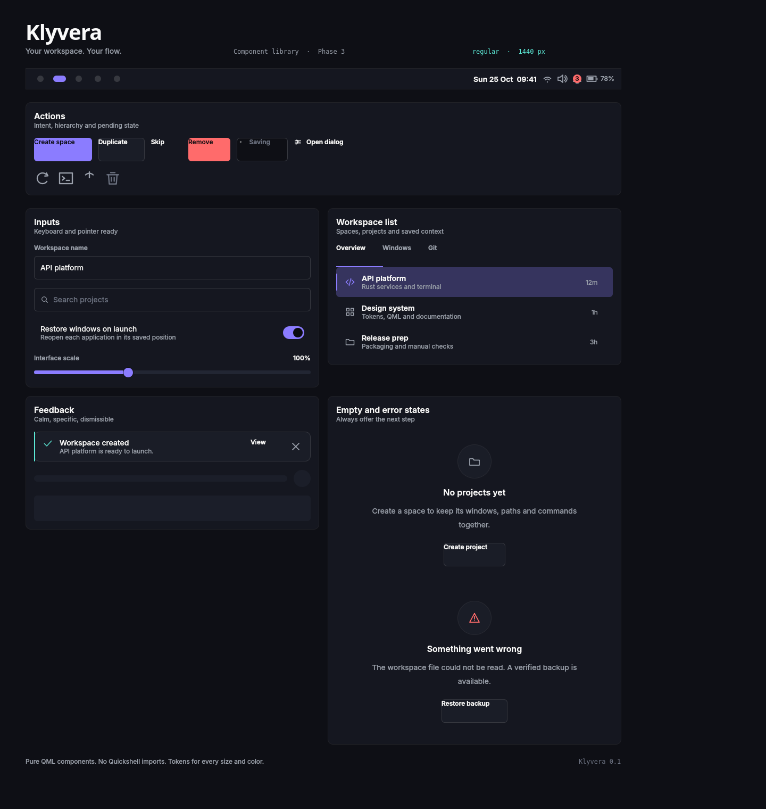

# Klyvera

**Your workspace. Your flow.**

Klyvera is an original, local-first Linux desktop for developers and technical
users. It pairs a calm, keyboard-first shell with project-based workspaces called
**Spaces**, so switching from one project to another switches the whole
environment with it.

> **Status: prototype.** Klyvera is under active development. It has not been
> run in a real Hyprland session on Arch Linux yet. See `docs/STATUS.md` for an
> honest list of what is done, what is unverified on target, and what is blocked.

## Components

| Component | What it does |
| --- | --- |
| **Klyvera Shell** | Panel, launcher, notifications, control center (Quickshell + QML) |
| **Klyvera Spaces** | Project-based workspace profiles: paths, apps, layout hints |
| **Klyvera Themes** | Token-driven dark, light and high-contrast appearance |
| **Klyvera Core** | Rust library, daemon and CLI for config, Spaces, backup and IPC |
| **Klyvera OS** | Later: an Arch-based ISO built with archiso |

## Principles

- **Local-first.** No accounts, no servers, no telemetry. Works offline.
- **Keyboard-first.** Every surface is reachable and usable without a mouse.
- **Token-driven.** Colour, spacing, type, motion and layout derive from one
  source of truth: `design/tokens.json`.
- **Safe by default.** Profiles never execute shell strings. Imported profiles
  are untrusted until explicitly confirmed.
- **Honest.** If a feature has not been run on the target, it is labelled
  unverified.

## Preview



The component gallery is rendered offscreen from mock data without Hyprland or
Quickshell. See `docs/design-system.md` and `docs/roadmap/PHASE-3.md`.

## Technology

Arch Linux base, Hyprland on Wayland, Quickshell and Qt 6 QML for the shell,
Rust for core services, JSON with JSON Schema for configuration, Vite and
TypeScript for the static website. See `docs/architecture.md`.

## Repository layout

```
design/     design tokens, generators, brand notes
docs/       vision, architecture, specs, decisions, roadmap, status
core/       Rust workspace (config, spaces, backup, ipc, daemon, cli)
shell/      pure QML components, Quickshell integration, pages, styles, assets
preview/    mock-data harness for rendering pure QML without Hyprland
schemas/    JSON Schemas for configuration and Spaces
packaging/  PKGBUILDs, archiso profile, installer assets
web/        static landing page and documentation site
scripts/    developer scripts
tests/      cross-component and end-to-end tests
```

## Development

Klyvera is developed on a Debian-based workstation; the target is Arch Linux.
Checks that can run locally:

```bash
./scripts/check.sh
```

Individual layers:

```bash
cd core && cargo fmt --check && cargo clippy --all-targets -- -D warnings && cargo test
python3 design/generators/generate.py --check
cd web && npm ci && npm run build && npm run check
python3 preview/render.py
```

Install the browser once and run the site accessibility checks against a
preview server:

```bash
cd web
npx playwright install chromium
npm run preview -- --host 127.0.0.1 --port 4173
BASE_URL=http://127.0.0.1:4173 npm run test:browser
```

Some checks (Hyprland, Quickshell, pacman, mkarchiso) cannot run on the
development workstation and are listed as **UNVERIFIED-ON-TARGET**.

## Documentation

Start with `docs/vision.md`, `docs/architecture.md` and `docs/STATUS.md`.
Product and engineering records live alongside them:

- `docs/website.md` — site structure, local build, checks and Pages deployment.
- `docs/threat-model.md` — assets, trust boundaries and residual risks.
- `docs/MANUAL_TEST.md` — local and Arch-target acceptance checks.
- `docs/TROUBLESHOOTING.md` — diagnosis without disabling security controls.
- `docs/RELEASE.md` — release gates, artifact manifest and signing gap.
- `docs/packaging.md` — packages, daemon sandbox and live image.

Contributor rules live in `AGENTS.md` and `CONTRIBUTING.md`.

## License

Licensed under the Apache License, Version 2.0. The maintainer has not finalized
the license yet; see `docs/decisions/0002-license.md`. Do not relicense without a
decision record.

Third-party components and their licenses are listed in
`THIRD_PARTY_NOTICES.md`; upstream credits are in `docs/CREDITS.md`.

Klyvera is an independent project. It is not affiliated with, endorsed by, or
sponsored by Arch Linux, Hyprland, Quickshell, or the Qt Company.
